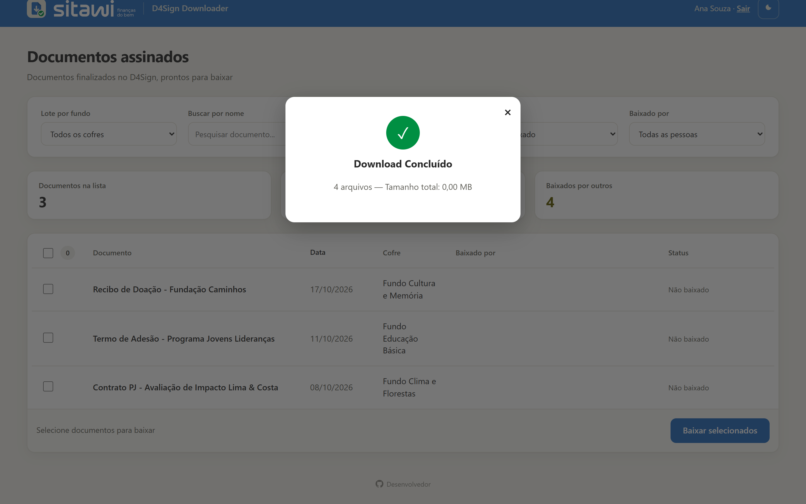

# D4Sign Downloader

App da equipe da Sitawi Finanças do Bem para baixar os documentos assinados na D4Sign, um a um ou em lote. Ele também registra quem da equipe já baixou cada documento, para ninguém baixar o mesmo arquivo duas vezes nem esquecer algum.


| Entrar com a conta Microsoft | Download em lote | Tema escuro | Celular |
|---|---|---|---|
|  |  |  |  |

*Capturas com documentos, cofres e pessoas fictícios.*

## Como funciona

- **Login:** com a conta Microsoft da Sitawi (Entra ID), a mesma do Outlook e do Teams. Só entram contas `@sitawi.net`. Enquanto o app não está registrado no Entra, vale o login com e-mail e senha, com ativação por link enviado por e-mail.
- **Lista:** documentos finalizados de todos os cofres da conta na D4Sign. A lista abre nos documentos que ninguém baixou ainda.
- **Filtros:** cofre, nome (busca ao digitar), período da assinatura, status e pessoa que baixou.
- **Status de cada documento**, do ponto de vista de quem está logado:
  - verde: **Baixado por mim** (o × desfaz a minha marcação)
  - amarelo: **Baixado por outro**
  - sem cor: **Não baixado**

  A coluna **Baixado por** mostra os nomes, e o e-mail aparece ao passar o mouse.
- **Contadores:** documentos na lista, baixados por mim e baixados só por outros, nos últimos 60 dias (ou desde o início do período filtrado).
- **Download:** um documento ou vários num único `.zip`. O app baixa até 6 documentos em paralelo da D4Sign, tenta de novo quando a API falha e avisa quais documentos não entraram. O zip é enviado aos poucos, então lotes grandes não pesam no servidor. Depois do download a lista se atualiza sem recarregar a página.
- **Visual:** logo e cores da Sitawi, tema claro e escuro (a escolha fica salva) e cartões no celular.

**Tecnologias:** Python e Flask, API REST da D4Sign, MSAL (Microsoft Entra ID), PostgreSQL no Supabase e e-mail pela Brevo. Hospedado no Render.

## Como rodar

1. Instale as dependências:

```bash
python -m venv .venv
.venv\Scripts\activate        # Linux/macOS: source .venv/bin/activate
pip install -r requirements.txt
```

2. Crie um arquivo `.env` com as variáveis abaixo.
3. Rode `python d4sign.py` e abra `http://localhost:5000`.

### Variáveis de ambiente

| Variável | Para quê |
|---|---|
| `TOKEN_API`, `CRYPT_KEY` | Credenciais da API da D4Sign |
| `HOST_D4SIGN` | URL da API. Padrão: sandbox (`https://sandbox.d4sign.com.br/api/v1`). Em produção, use a URL de produção |
| `DATABASE_URL` | PostgreSQL (Supabase, *Session pooler*). Sem ela, o app roda sem login e guarda o histórico em `downloads.json` |
| `SECRET_KEY` | Chave das sessões. Sem ela, as sessões caem a cada reinício |
| `MS_CLIENT_ID`, `MS_TENANT_ID`, `MS_CLIENT_SECRET` | Login Microsoft: ID do aplicativo (cliente), ID do diretório (locatário) e **Valor** do segredo do cliente. Com as três, o login com senha sai do ar |
| `MS_REDIRECT_URI` | Opcional. Padrão: `<site>/auth/callback` |
| `DOMINIO_PERMITIDO` | Domínio aceito no login. Padrão: `sitawi.net` |
| `BREVO_API_KEY`, `EMAIL_REMETENTE`, `EMAIL_REMETENTE_NOME` | E-mail de confirmação do login com senha. Alternativa: `SMTP_HOST`, `SMTP_PORT`, `SMTP_USUARIO`, `SMTP_SENHA`. Sem nenhum dos dois, o link aparece no log |
| `APP_URL` | Endereço público do site para os links de e-mail. No Render, `RENDER_EXTERNAL_URL` já vem preenchida |
| `D4SIGN_DOWNLOAD_WORKERS` | Downloads em paralelo. Padrão: 6 |
| `REDIS_URL`, `D4SIGN_AUTO_REFRESH_INTERVAL` | Cache opcional e intervalo da atualização automática (padrão: 3600 s) |

As tabelas do banco e as permissões do usuário do app estão em [`supabase.sql`](supabase.sql).

### Login Microsoft (Entra ID)

No centro de administração do Microsoft Entra:

1. Registre o app como **single-tenant** (só contas da organização).
2. Cadastre a redirect URI do tipo **Web**: `<site>/auth/callback`.
3. Crie um **segredo do cliente** e guarde o **Valor** dele, que só aparece uma vez.
4. Se o tenant não deixar as pessoas consentirem sozinhas, conceda o consentimento do administrador às permissões básicas (`openid`, `profile`, `User.Read`).

Cada pessoa é ligada pela conta do mesmo e-mail na tabela `usuarios`, então quem já usava o login com senha continua com o próprio histórico de downloads.

### No Render

Crie um *Web Service* ligado a este repositório, com build `pip install -r requirements.txt`, início `python d4sign.py` e as mesmas variáveis do `.env`.

## Estrutura

| Arquivo | Função |
|---|---|
| `d4sign.py` | App Flask: lista, filtros, downloads e webhook da D4Sign |
| `auth.py` | Login (conta Microsoft ou e-mail e senha), cadastro e confirmação por e-mail |
| `registro.py` | Contas e histórico de downloads por pessoa |
| `email_envio.py` | Envio de e-mails pela Brevo ou por SMTP |
| `supabase.sql` | Tabelas e permissões do banco |
| `static/` | Logo do app e logos oficiais da Sitawi |
| `docs/` | Capturas usadas neste README |

Os segredos ficam só nas variáveis de ambiente, nunca no Git.

## Licença

© 2025-2026 [Ryan G. Santos](https://github.com/offryan). Todos os direitos reservados. O código é público apenas para portfólio e avaliação. Veja o [LICENSE](LICENSE).
